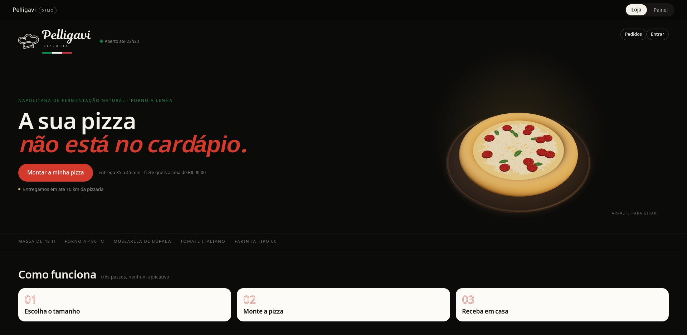
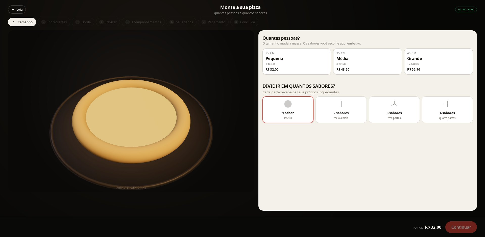
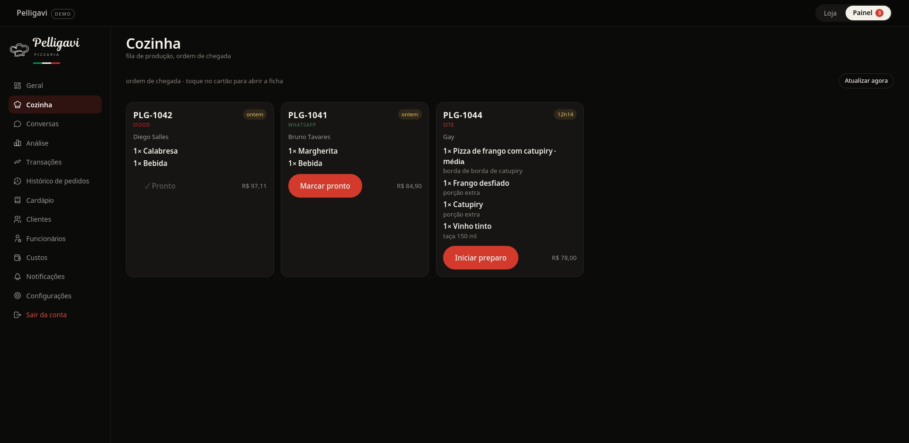
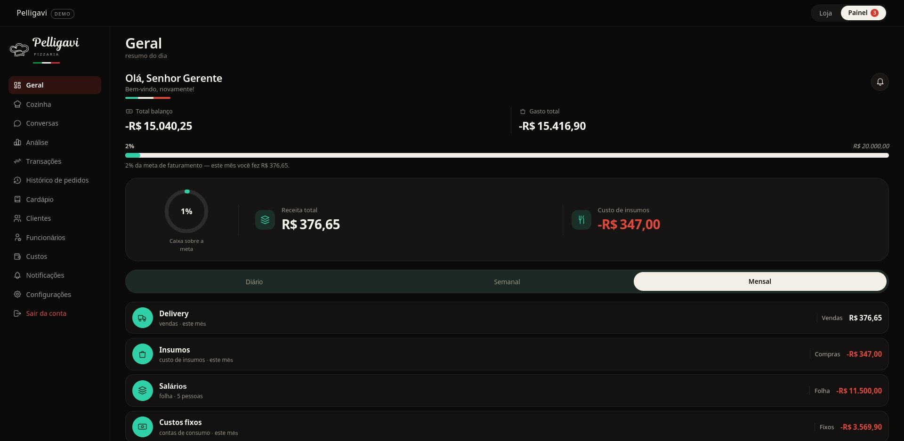

# Pelligavi — demo de pedidos e gestão para pizzaria

Demonstração de ponta a ponta de uma pizzaria napolitana fictícia: o cliente monta a pizza num
modelo 3D, paga no PIX ou no cartão, e o pedido cai na fila da cozinha e no painel gerencial.
Tudo roda local, num único comando, com banco PostgreSQL de verdade — não é mock nem protótipo
estático.



## O que tem na demo

**Loja** — página inicial com a pizza 3D girando, e o estúdio de montagem em oito etapas:
tamanho (25/35/45 cm), divisão em 1 a 4 sabores, ingredientes por parte (30 ingredientes,
vendidos por porção em gramas, com limite de 3× cada), borda tradicional ou recheio dentro da
borda, acompanhamentos, dados de entrega, pagamento e confirmação.



**Cozinha** — fila na ordem de chegada, com os itens do pedido e o botão que avança o status.
Cada transição grava no histórico e dispara a notificação.



**Painel gerencial** — faturamento, gasto, balanço, custo de insumos, meta do período e a
composição entre delivery, insumos, salários e custos fixos; mais cardápio, ingredientes e
receitas, custos, funcionários, relatórios, CRM de conversas e configuração da loja.



## Stack

- **Front-end** — React 19 + Vite + TypeScript, three.js para o palco 3D
- **Back-end** — Node.js 20 + Express 5 + TypeScript, `pg` e validação com `zod`
- **Banco** — PostgreSQL 17 (o esquema roda a partir do 14), com as regras de negócio dentro do
  banco: chaves, restrições, triggers, functions e procedures em PL/pgSQL
- **Sessão** — JWT com senha de gerente em scrypt; código de verificação simulado no modo demo

## Requisitos

- Node.js **20 ou superior** e npm
- PostgreSQL **14 ou superior** rodando na máquina

## Rodando em um comando

```bash
git clone https://github.com/leonardoag2026-beep/pelligavi-demo.git
cd pelligavi-demo
cp .env.example .env     # ajuste a senha do PostgreSQL neste arquivo
./start.sh
```

O script confere o ambiente, cria o banco `pelligavi` se ele não existir, aplica os 43 scripts
SQL na ordem numérica, instala as dependências, compila o servidor e o site, e sobe tudo em
`http://127.0.0.1:8888`.

Outros modos:

```bash
./start.sh --recriar     # apaga o banco e roda os scripts do zero
./start.sh --dev         # API com TypeScript em watch + Vite com hot reload
./start.sh --sem-build   # pula a compilação e sobe o que já está compilado
./start.sh --ajuda       # lista as opções
```

No Windows, rode pelo **WSL** ou pelo Git Bash.

## Rodando passo a passo (sem o script)

```bash
# 1. banco
createdb pelligavi
for f in $(ls db/*.sql | sort); do psql -d pelligavi -v ON_ERROR_STOP=1 -f "$f"; done

# 2. dependências
npm install
npm --prefix web install

# 3. compilar servidor e site
npm run build
npm run web:build

# 4. subir
npm run serve          # http://127.0.0.1:8888
```

Para desenvolver com recarga automática: `npm run web:dev` (site em outra porta, com proxy para a
API) e `npm run serve` em outro terminal.

## Onde ficam as coisas

```
db/                 43 scripts SQL numerados: esquema, dados de exemplo, objetos e cada módulo novo
server/
  bootstrap/        sobe o Express, serve o site compilado e as mídias
  config/           conexão com o PostgreSQL e variáveis
  modules/          14 módulos: pedidos, cardápio, ingredientes, caixa, pagamentos, custos,
                    clientes, funcionários, relatórios, notificações, crm, geo, config, auth
                    (cada módulo com routes, controllers, services, repositories e schemas)
  shared/           rotas, tipos e utilidades comuns
  uploads/          modelos 3D, texturas e imagens servidos em /modelos, /texturas e /imagens
web/                o site em React 19 + Vite (api, features, pages, shared)
scripts/            utilitários de operação (demo do banco, URL do túnel)
```

## O banco

**36 tabelas**, **8 views**, **11 functions**, **6 procedures** e **10 triggers**. A API chama esses
objetos em vez de repetir a regra no Node: os relatórios leem as views, o desconto vem de
`calcular_desconto`, o cancelamento passa por `cancelar_pedido`, o fechamento por `fechar_caixa` e a
anonimização por `anonimizar_cliente`. Alguns exemplos do que está dentro dele:

- `registrar_pedido` — grava pedido e itens numa transação, com o preço pelo sabor mais caro
- `avancar_status` — transição de status com histórico e notificação, por trigger
- `pedido_abre_conversa` — o pedido cria a conversa do CRM automaticamente
- `fn_total_pedido`, `fn_desconto_pedido` — total e desconto calculados no banco
- `vw_fila_cozinha`, `vw_faturamento_dia`, `vw_custo_receita` — as visões que alimentam a cozinha
  e o painel

Os 43 scripts não são um bloco só: `01` a `03` são núcleo, dados e objetos; do `04` em diante cada
arquivo é uma mudança de módulo (entrega, geo, CRM, geometria da pizza, composição do item). Rodar
tudo em ordem reconstrói o banco exatamente como o da demonstração.

Dá para exercitar as regras direto no `psql`:

```sql
-- pedido com meio a meio, taxa de entrega e desconto por faixa
CALL registrar_pedido(1, NULL, 1, 1, 1,
                      '[{"id_tamanho":2,"quantidade":2,"produtos":[1,2]}]'::jsonb, NULL);
CALL cancelar_pedido(1, 'cliente desistiu');   -- só até o status Pronto
CALL anonimizar_cliente(5);                    -- LGPD: apaga os dados pessoais
SELECT * FROM vw_fila_cozinha;                 -- o que a cozinha vê
```

## API

Todas as rotas ficam sob `/api`. As principais:

```
GET  /api/saude                    estado do serviço e do banco
GET  /api/cardapio                 tamanhos, sabores, bordas, acompanhamentos
GET  /api/ingredientes             ingredientes com classe, custo e preço por porção
POST /api/pedidos                  registra o pedido (transação no banco)
GET  /api/pedidos                  lista com filtros de período e status
PATCH /api/pedidos/:id/status      avança o status (histórico + notificação)
GET  /api/relatorios/...           faturamento, custos e balanço por período
GET  /api/crm/conversas            conversas geradas pelos pedidos
POST /api/auth/login               login do painel (JWT)
```

## Entrando no painel

`http://127.0.0.1:8888/painel` — login `gerente@pelligavi.com`, senha `pizzaria2026`. O código de
verificação aparece na tela porque `OTP_MOCK=1` (só para demonstração).

## Aviso

Projeto acadêmico, feito para a disciplina de Banco de Dados 2. Nada é cobrado de verdade, não há
integração real com gateway de pagamento, WhatsApp ou marketplaces, e os dados são fictícios.
